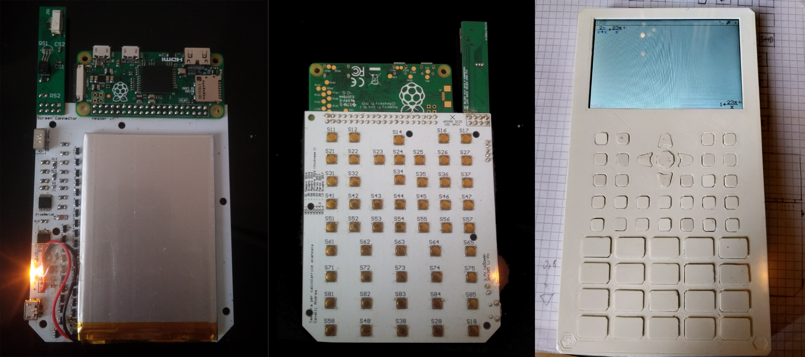
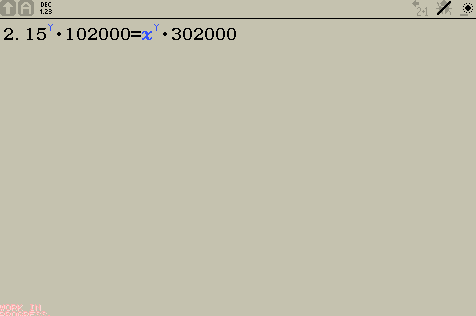
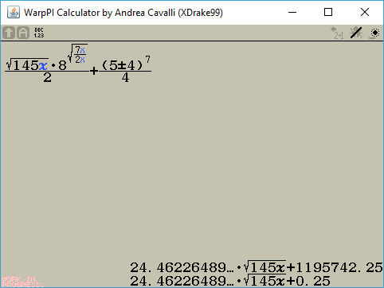
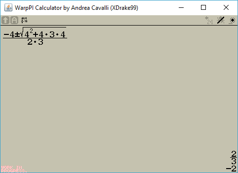

# WarpPI Calculator
Step-by-step algebra calculator for Raspberry PI.

**This project is experimental and strictly related to my calculator, designed to run on a Raspberry Pi.** 
Java 25 is required. The Raspberry Pi hardware build targets the project's Java 25 ARMv6 Buildroot image.
GPIO uses the Java 25 Foreign Function and Memory API to map `/dev/gpiomem` directly. The GPIO path does not use Pi4J or a project JNI library. The keypad's BCM GPIO lines 13, 16, 19, 20, 21, and 26 must be dedicated to WarpPI. The executable hardware JAR enables native access in its manifest; class-path launches must pass `--enable-native-access=ALL-UNNAMED`.
**Many fundamental features are missing, this project is still in its infancy.** 

**If you really want to build and test it on your computer take account of that.**

# Live preview
This preview has been built using TeaVM: a JVM made in javascript.
Obviously it runs slower than the original.
https://local.cavallium.it/calculator/

# Keypad PCB
https://workspace.circuitmaker.com/Projects/Details/Andrea-Cavalli/Scientific-calculator-Keypad

# Photos and pictures

